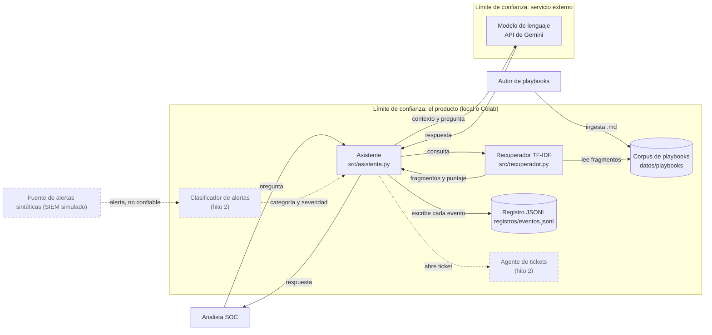

# Arquitectura

Este diagrama corresponde al código del **hito 1**. Lo dibujado con línea continua existe en `src/`; lo dibujado con línea punteada es el plan para el hito 2 y **todavía no está implementado**.

## Flujos

| # | Flujo | Archivo | Estado |
|---|-------|---------|--------|
| 1 | El analista envía una pregunta al asistente | `src/asistente.py` | Hito 1 |
| 2 | El asistente recupera los fragmentos más similares del corpus (TF-IDF, coseno, `k = 3`) | `src/recuperador.py`, `src/ingesta.py` | Hito 1 |
| 3 | Si el puntaje supera el umbral, el asistente envía el contexto y la pregunta a Gemini | `src/llm.py` | Hito 1 |
| 4 | Sin llave de API, o si Gemini falla, el asistente devuelve los fragmentos recuperados (modo extractivo) | `src/asistente.py` | Hito 1 |
| 5 | Cada consulta, los documentos recuperados, las herramientas invocadas y la respuesta se guardan en el registro | `src/registro.py` | Hito 1 |
| 6 | Una alerta sintética se clasifica por su descripción | `src/clasificador` | Hito 2 (pendiente) |
| 7 | El agente abre un ticket según la clasificación | `src/agente` | Hito 2 (pendiente) |

## Límites de confianza

1. **Analista → asistente.** El texto de la pregunta es entrada no confiable: puede contener instrucciones dirigidas al modelo.
2. **Corpus → modelo de lenguaje.** Los fragmentos recuperados pasan al contexto del modelo. Si alguien con acceso de escritura al corpus incluye instrucciones en un playbook, el modelo las recibe junto con el texto legítimo. El prompt del sistema pide tratar el contexto como datos, pero eso no es un control verificado: se medirá en la evaluación adversarial.
3. **Producto → Gemini.** La pregunta y los fragmentos salen del equipo hacia un tercero. Por eso todos los datos son sintéticos.
4. **Alertas del SIEM → clasificador** (hito 2). El campo de descripción de una alerta lo puede escribir un atacante, por ejemplo mediante el nombre de un archivo o un agente de usuario. Es un segundo punto de inyección.
5. **Archivo `.env` → producto.** La llave de Gemini vive solo en `.env`, excluido por `.gitignore`.

## Decisiones de diseño

- **Recuperación léxica (TF-IDF) en lugar de embeddings.** Corre sin red ni llaves y permite reproducir los resultados con un solo comando. Su límite es que no entiende sinónimos: una pregunta sin los términos del playbook puede recuperar el documento equivocado. Se documentará en la evaluación.
- **Modo extractivo como respaldo.** El producto funciona sin llave, de modo que las pruebas y el registro de ejemplo no dependen de un servicio externo.
- **Registro en JSONL.** Una línea por evento, fácil de leer con cualquier herramienta y de contrastar con la columna «señal en el registro» del modelo de amenazas.
